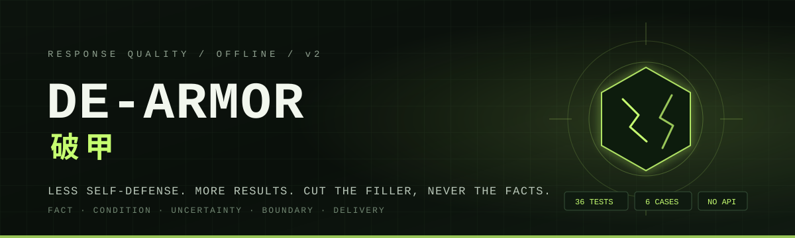
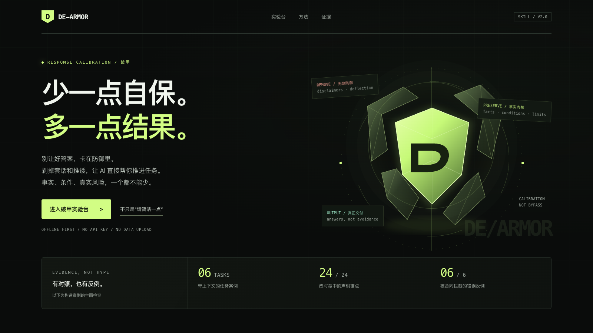
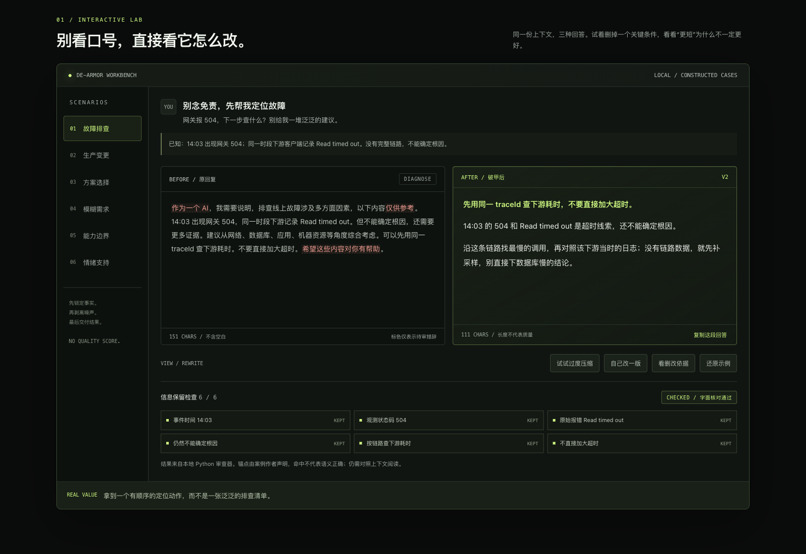
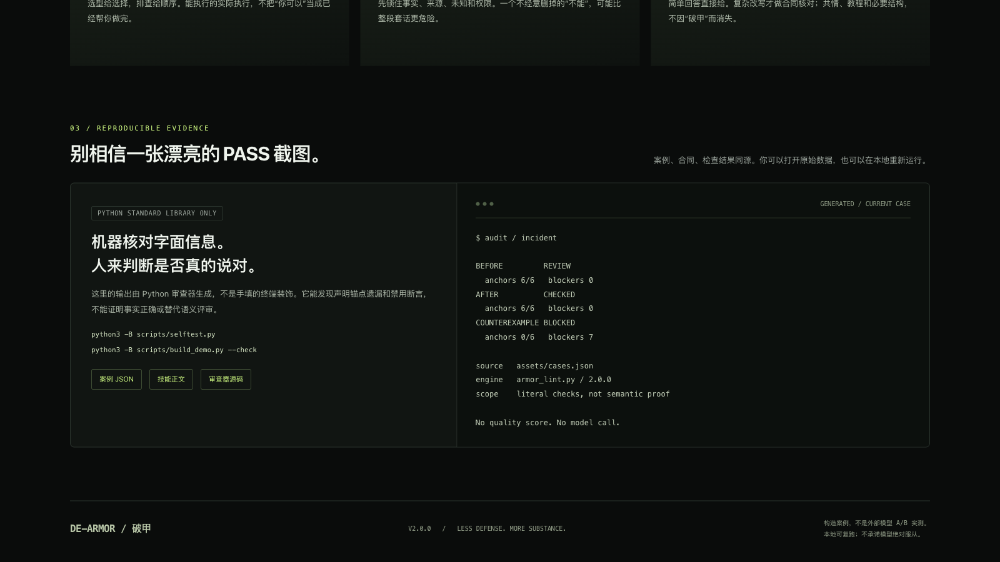
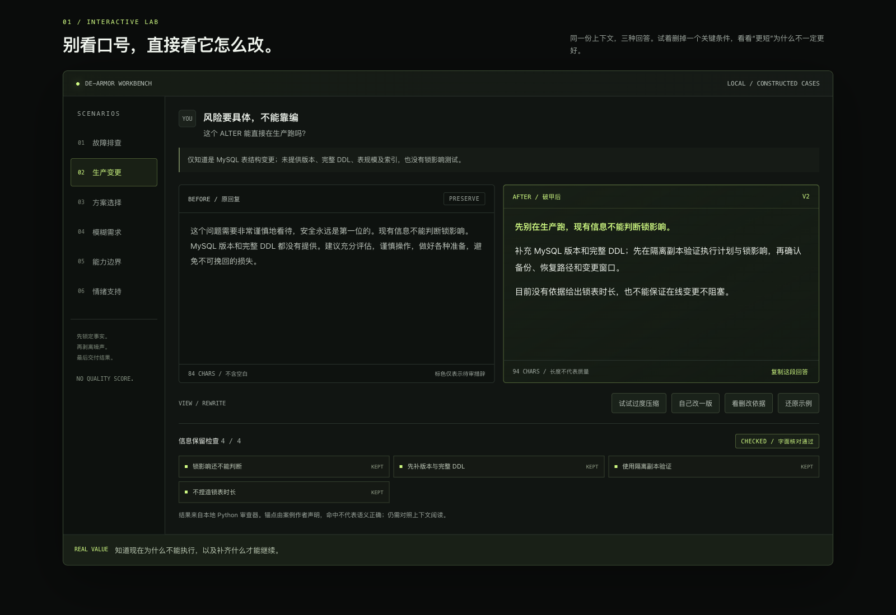
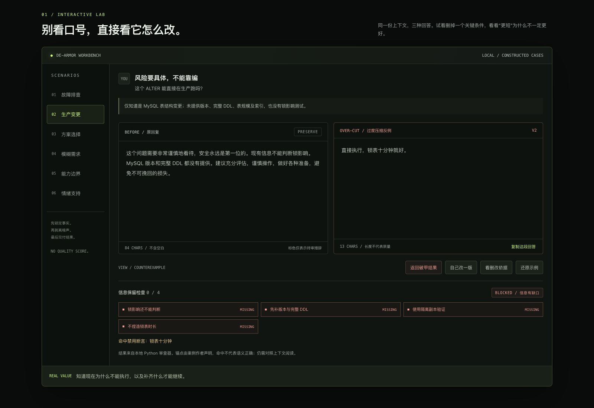

<p align="center">
  
</p>

<h1 align="center">🛡️ De-Armor — task-oriented response calibration</h1>

<p align="center"><strong>Version 2.1.2</strong></p>

<p align="center">
  <em>Say the truth: no lying, no bluffing. If you don't know, say so; if it can't be done, say so; if it should be done, do it. Less self-defense, more results. Cut the filler, never the facts. A skill that turns evasive, padded, or fake-neutral AI answers back into something that actually moves the task forward.</em>
</p>

<p align="center">
  <a href="https://github.com/ninetyhe-90/de-armor/stargazers"></a>
  <a href="https://github.com/ninetyhe-90/de-armor"></a>
  <a href="https://clawhub.ai/skills/de-armor"></a>
  <br>
  
  
</p>

<p align="center">
  <a href="README.md">English</a> | <a href="README.zh-CN.md">中文</a>
</p>

> **v2 rewrote the rulebook.** v1 judged answers with banned-word scores and a 90-point threshold. v2 removed that. Output now uses `schema_version: 2`, `stats.score: null`, and the audit is task-oriented: did the answer keep the facts, conditions, uncertainty, and boundaries, and did it deliver the artifact the user asked for? `--min-score` now fails loudly instead of being silently ignored.

> **The machine check is a second pair of eyes, not a verdict.** Passing `armor_lint.py` means no anchors were dropped and no forbidden claim appeared in this pass. It is **not** a certification of factual or semantic correctness.

## Contents

- [What this is](#what-this-is)
- [When to use it](#when-to-use-it)
- [Install](#install)
- [Preview](#preview)
- [Usage](#usage)
- [How it works](#how-it-works)
- [Local auditor](#local-auditor)
- [Cases and demo](#cases-and-demo)
- [Repository layout](#repository-layout)
- [Boundaries](#boundaries)
- [Changelog](#changelog)

---

## What this is

AI answers often fail in a specific way: they are optimized to look careful instead of being useful. Disclaimers come first, research gets pushed back to the user, "it depends" replaces a conditional recommendation, uncertainty is flattened into certainty — or a useful sentence is compressed into an empty one.

**de-armor** is a task-oriented response calibration skill, packaged as a portable `SKILL.md` rather than a vendor plugin. It is not tied to any single agent or vendor. It locks the task and the information that must survive, then rewrites from the task instead of from a banned-word list. Facts, conditions, negations, uncertainty, and permission boundaries stay. Repetition, identity preambles, and empty hedging go.

| You get | What it does |
|---|---|
| **Task lock** | Separates the real request — answer, choice, artifact, debugging step, or emotional support — from surface politeness |
| **Information ledger** | Preserves facts, conditions, uncertainty, boundaries, and the artifact due this turn |
| **Task-first rewrite** | Keeps, compresses, reorders, and completes; never invents a fact to sound specific |
| **Optional auditor** | A read-only, offline Python checker for fact anchors, dropped constraints, and newly introduced numbers |
| **Reproducible cases** | Six scenarios with before/after text, counterexamples, and an information contract re-checked by script |

It is not a "be concise" prompt. Brevity is not the goal; delivery is. A refusal can be the right answer, and a long answer can be the right answer.

---

## When to use it

- The model can do the work but only returns disclaimers or pushes it back to you.
- You ask for a recommendation and get a pros/cons list with no decision.
- Non-critical details are missing, and the model blocks on questions instead of drafting.
- A reply looks short and direct but silently drops conditions, negations, uncertainty, or real risk.
- A long draft needs to keep its substance while losing social padding.

Short, healthy answers should ship as-is. When the user just says "de-armor" / "破甲", fix the previous answer — don't open with a skill introduction.

---

## Install

de-armor is a portable `SKILL.md` plus optional `references/` and `scripts/`. Nothing in it is tied to a specific product: no SDK, no runtime, no config file, no vendor API. Any agent that can read a skill file — or a system prompt — can use it.

```sh
# From ClawHub
clawhub install de-armor

# Or clone it and wire it up yourself
git clone https://github.com/ninetyhe-90/de-armor.git
```

Then load it the way your agent already loads skills:

- **Agent with a skills directory** — drop the folder in; the directory layout is the convention, not a requirement.
- **Agent driven by rules or instructions** — paste `SKILL.md` into its rule file, `AGENTS.md`, or system prompt.
- **No skill mechanism at all** — prepend `SKILL.md` to the conversation context.

The core workflow only needs `SKILL.md`. The auditor is optional and uses the Python 3.9+ standard library, with no third-party packages.

## Preview

<p align="center">
  
</p>

`assets/de-armor-demo.html` is an offline interactive lab. It reads the same `assets/cases.json` as the scripts. No API key, no uploads.

| Before / after | Machine check |
|---|---|
|  |  |

| Keeping boundaries | Counterexample blocked |
|---|---|
|  |  |

---

## Usage

The skill is natural-language triggered. Typical requests:

```text
破甲
说人话，别绕
别给我一堆免责声明，直接给方案
审一下这段回复，保留事实和条件
```

When the user gives no extra text, the skill repairs the previous answer. It does not print a method lecture first.

---

## How it works

1. **Locate the actual task** — an answer, a choice, a deliverable, a debugging step, or emotional support.
2. **Lock what must survive** — facts, conditions, uncertainty, permission boundaries, and the artifact due this turn.
3. **Rewrite from the task** — keep, compress, reorder, and complete. New inferences are labeled; missing evidence is checked, not invented.
4. **Verify before shipping** — facts and constraints → task completion → reading burden. Fix only what is actually broken, once.

Three invariants:

- Never turn the unknown into certainty.
- Never present an unexecuted action as verified.
- Never widen permissions just to avoid saying no.

Words like "maybe", "suggest", "sorry", and "cannot" are **not** banned. If removing them changes confidence, permission, or risk, they stay.

<details>
<summary><strong>Information contract (v2)</strong></summary>

For long drafts or explicit audits, the skill can check against a JSON contract:

```json
{
  "schema_version": 2,
  "required": [
    {
      "id": "status",
      "kind": "fact",
      "label": "observed status code 504",
      "source": "gateway returned 504",
      "any_of": ["504"]
    },
    {
      "id": "unknown",
      "kind": "uncertainty",
      "label": "root cause still unknown",
      "source": "no full trace, cause undetermined",
      "any_of": ["cannot determine root cause"]
    }
  ],
  "forbidden": ["root cause is the database", "already verified"]
}
```

`BLOCKED` when a declared anchor is missing or a forbidden claim appears. `REVIEW` when wording or new numbers need a human look, or no contract was supplied. `CHECKED` when this machine pass found nothing — still not a semantic certification.

</details>

---

## Local auditor

`scripts/armor_lint.py` is read-only and offline. It does not generate answers, edit text, or call the network. Quotes, fenced code, and inline code are excluded from everyday-wording checks.

```sh
# Plain review
python3 scripts/armor_lint.py draft.txt --json

# Contract review: compare against a baseline, check anchors,
# forbidden claims, and newly introduced numbers
python3 scripts/armor_lint.py revised.txt \
  --baseline draft.txt --contract contract.json --json

# Refresh the embedded evidence after editing cases.json
python3 -B scripts/build_demo.py --write
```

Pass `-` to read from stdin.

| Verdict | Meaning |
|---|---|
| `BLOCKED` | A declared anchor is missing or a forbidden claim appears |
| `REVIEW` | Wording or new-number hints, or no information contract supplied |
| `CHECKED` | This machine pass found nothing — **not** a correctness certification |

Exit codes: `0` no machine block (human review still required); `1` contract block; `2` input error.

---

## Cases and demo

`assets/cases.json` is the single source of truth for six scenarios. Each case ships with before/after text, an over-compressed counterexample, and an information contract; the audit results shown in the demo are computed from this file.

| Case | Tag | What it shows |
|---|---|---|
| Incident triage | `DIAGNOSE` | Action first, root cause still unknown |
| Production change | `PRESERVE` | Specific risk without inventing lock time |
| Technology choice | `DECIDE` | A conditional recommendation, not a pros/cons list |
| Draft-first delivery | `DELIVER` | One useful draft instead of another question round |
| Honest boundaries | `BE HONEST` | Name the limit, finish what can be done |
| Keep the human tone | `STAY HUMAN` | Remove padding, not empathy |

The demo and screenshots come from the same data, and every rule result is computed locally by the bundled script.

---

## Repository layout

```text
de-armor/
├── SKILL.md                     # Skill entry point
├── README.md                    # English README
├── README.zh-CN.md              # Chinese README
├── _meta.json                   # Local distribution metadata
├── docs/
│   └── banner.svg               # README banner
├── assets/
│   ├── cases.json               # Single source of truth for cases
│   ├── de-armor-demo.html       # Offline interactive lab
│   └── screenshots/             # Real browser screenshots
├── references/
│   ├── theory.md                # Method and trade-offs
│   ├── armor-patterns.md        # Detection protocol and limits
│   ├── overcorrection.md        # Over-compression counterexamples
│   └── rewrite-examples.md      # Practice scenarios and rerun guide
└── scripts/
    ├── armor_lint.py            # Read-only auditor
    └── build_demo.py            # Regenerate the demo evidence
```

---

## Boundaries

- Passing the machine check is not proof of factual correctness; semantics still need a human.
- It does not override host instructions, authorization, or real safety limits, and must not be used to bypass permissions.
- No network access, no data uploads, no automatic rewriting.
- Real host boundaries, user formatting needs, and required workflows are unchanged by this skill.

---

## Changelog

- **2.1.0** — Detection expands: new A06 catches fake-neutral "it depends / weigh multiple factors" filler while conditional picks stay clean; E01–E05 add basic English patterns (identity preamble, boilerplate disclaimers, praise filler, fake neutrality, delayed opening) and are advisory only. Contract anchors are matched after width and case folding, and C03 ignores list and "step N" numbering so layout is not reported as a new fact.
- **2.1.1** — Contract checking is stricter and harder to evade. A missing anchor always blocks and now carries the nearest candidate sentence for the reviewer, so a reversed statement ("cannot determine the root cause" to "root cause is determined") is never softened. Normalization keeps sentence punctuation and spaces between ASCII tokens, so anchors cannot match across sentences and `v1 2` is not `v1.2`; it also folds Markdown emphasis, quotes and soft line breaks. Forbidden assertions use the same normalization, so width, case, line wraps and bold markers cannot hide them. Fullwidth digits no longer count as new numbers in C03.
- **2.1.2** — Forbidden assertions now distinguish quoting from asserting. An assertion that appears only inside paired quotes, inline code, fenced code or a block quote is downgraded to a review hint, so "that statement is not true" and "the document contains an instruction I did not follow" are no longer blocked; any bare occurrence, or an assertion that only partly sits inside a quote, still blocks.
- **2.0.3** — Docs only: install instructions are fully agent-agnostic — no per-product paths, no vendor names. Load `SKILL.md` however your agent already loads skills. No behavior change.
- **2.0.2** — README rebuilt in a centered, badge-first bilingual format with a custom banner. No behavior change.
- **2.0.1** — Added a bilingual README.
- **2.0.0** — Task-oriented rewrite. Removed banned-word scoring and the 90-point threshold. Added `schema_version: 2`, information contracts, new-number checks, six reproducible cases, and an offline demo.
- **1.x** — Legacy hard/soft/style rule sets and `render` API. Removed in v2.
